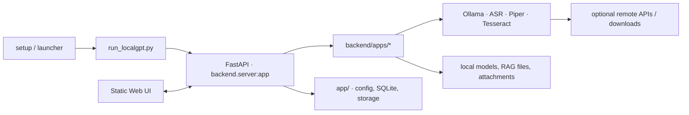

# LocalGPT

LocalGPT — local-first приложение для чата, транскрибации, синтеза речи, OCR и RAG. При работе с локальными providers пользовательские данные, модели и runtime-артефакты по умолчанию сохраняются на этом компьютере; настроенные внешние providers, package managers и загрузчики моделей могут передавать запросы или скачивать файлы по сети.

## Возможности

- чат с профилями, историей, streaming-ответами, image attachments и локальными text/vision Ollama-моделями;
- Auto / Smart Router для выбора chat-модели по типу запроса;
- ASR Studio и быстрый voice-to-input через whisper.cpp или faster-whisper;
- анализ транскриптов: быстрое саммари, умное саммари и явно разрешаемый полный pipeline;
- Voice Studio на базе Piper с локальной библиотекой голосов и историей;
- OCR изображений через Tesseract;
- profile-scoped RAG для Markdown-файлов, включая ASR context и явно сохраняемый text-only Vision context;
- перенос complete Ollama, faster-whisper, whisper.cpp и Piper моделей между установками через один `.localgpt-models` bundle;
- metadata-only Plugin Registry v0;
- локальный доступ по умолчанию и явно включаемый LAN-доступ.

## Стек

- Python, FastAPI, Uvicorn, SQLite;
- Ollama / OpenAI-compatible API для chat-моделей;
- whisper.cpp и faster-whisper для ASR;
- Piper для TTS;
- Tesseract для OCR;
- статический Web UI на HTML, CSS и JavaScript;
- Caddy для отдельного LAN HTTPS режима на macOS;

## Архитектура



Обычный запуск слушает localhost; внешний provider или загрузчик подключается только в соответствующем настроенном/явно запущенном сценарии. Подробности data flows — в [ARCHITECTURE.md](docs/ARCHITECTURE.md).

## Первый запуск проекта

В репозитории есть platform entry points для macOS, Linux и Windows. Скрипт определяет ОС/package manager, открывает Terminal/PowerShell, показывает недостающие компоненты и запрашивает согласие перед каждой установкой. Наличие entry point не означает подтверждённую поддержку: см. [DEPENDENCIES.md](docs/DEPENDENCIES.md).

macOS — двойной клик по `setup/setup_localgpt.command` или команда:

```bash
./setup/setup_localgpt.command
```

Linux:

```bash
./setup/setup_localgpt.sh
```

Windows — двойной клик по `setup\setup_localgpt.bat`. Он откроет PowerShell и продолжит установку там.

Setup (технически — bootstrap):

- при необходимости устанавливает Python и поддерживаемый package manager;
- ставит обязательные system/runtime tools и закреплённые Python packages в `venv/`;
- отдельно предлагает опциональные Caddy и Node.js;
- на macOS собирает штатный `whisper-cli` и небольшой Silero VAD-фильтр от распознавания тишины, но не загружает ASR-модели и CoreML-артефакты;
- безопасно пропускает уже найденные компоненты и пригоден для повторного запуска;
- не скачивает речевые/LLM-модели или RAG-данные, не создаёт `.env` и не включает LAN-доступ LocalGPT;
- для установки недостающих Python/system components использует настроенный package manager и может обращаться к официальным download endpoints.

Канонический список Python packages находится в `app/requirements.txt`; отдельного корневого `requirements.txt` нет. Setup создаёт штатный `venv/`. Если ранее было вручную создано `.venv/`, оно останется нетронутым, но LocalGPT его не использует.

После успешной финальной проверки запускайте LocalGPT обычным launcher-ом из следующего раздела. Полный подтверждённый inventory, версии и назначение компонентов: [Зависимости LocalGPT](docs/DEPENDENCIES.md).

## Требования и ограничения

Для runtime используются:

- Python 3.11+;
- достаточно свободного диска под выбранные модели;
- Ollama для LLM-функций.

По используемым функциям:

- `ffmpeg` — конвертация аудио и часть ASR/TTS сценариев;
- `whisper-cli` (собирается setup-ом на macOS) и GGML-модель — для backend `whisper_cpp`;
- Tesseract — для OCR;
- Caddy — для явно включаемого LAN HTTPS режима на macOS;

## Обычный запуск

1. При необходимости создайте локальную конфигурацию:

   ```bash
   cp .env.example .env
   ```

   Задайте в `.env` непустой случайный `ADMIN_TOKEN`, если нужны restart/shutdown, database cleanup/reset, изменение model storage paths или защищённая prompt/runtime diagnostics. Web UI запрашивает его только при такой операции и хранит лишь до закрытия browser session.

2. Запустите приложение:

   macOS / Linux:

   ```bash
   ./start_localgpt.sh
   ```

   Windows:

   ```bat
   start_localgpt.bat
   ```

   macOS `.command`:

   ```text
   start_localgpt.command
   ```

Launcher повторно использует подготовленный `venv/`, при изменении `app/requirements.txt` обновляет packages, проверяет Ollama, выбирает свободный backend-порт и запускает `backend.server:app` только на localhost. LAN listener не поднимается при обычном запуске; на macOS обычный launcher также останавливает Caddy listener предыдущего LAN-сеанса. Если порт занят, launcher выбирает следующий свободный.

Команда `python3 run_localgpt.py` также поддерживается: если системный `python3` старее 3.11, launcher автоматически продолжит через подготовленный `venv/bin/python`. Системный Python при этом не изменяется.

Полезные варианты:

```bash
venv/bin/python run_localgpt.py --no-browser
venv/bin/python run_localgpt.py --no-reload
venv/bin/python run_localgpt.py --host 127.0.0.1 --port 8000 --strict-port
```

Параметры окружения, `ADMIN_TOKEN`, model paths, CORS и ASR/TTS настройки перечислены в [`.env.example`](.env.example).

## LAN доступ

Для доступа в одной локальной сети на macOS явно запустите `start_localgpt_lan.command` или `./start_localgpt_lan.sh`. Этот режим оставляет backend на localhost и поднимает Caddy HTTPS на частном LAN IP. TLS шифрует соединение, но приложение не предоставляет общую аутентификацию для LAN-клиентов; используйте только доверенную сеть. Остановить listener можно через `stop_localgpt_lan.command` или `./stop_localgpt_lan.sh`. Подробности и диагностика: [networking](docs/knowledge/networking.md).

## Данные и модели

Основные локальные пути:

- `models/ollama/` — chat-модели;
- `models/whisper/` и `models/whisper_cpp/` — ASR;
- `models/tts/piper/` — Piper voices;
- `models/hf_cache/` и `models/ctranslate2_cache/` — кэши;
- `app/db/localgpt.db` — SQLite;
- `rag_sources/profile-<id>/` — документы профиля;
- `app/data/chat_attachments/profile-<id>/` — оригиналы и thumbnails chat-изображений;
- `app/data/tts/` и `tmp_logs/` — runtime-артефакты.

Эти текущие runtime-пути игнорируются Git. Пустая `LOCAL_MODEL` допустима: приложение запускается без chat-модели, а загрузка выполняется только по явному действию пользователя. Ignore rules не удаляют уже закоммиченные blobs: аудит доступной Git-истории обнаружил исторические credential-like значения и записи чатов. Публичная публикация этого репозитория пока заблокирована; детали и требуемые действия владельца — в [отчёте readiness/security](docs/security/OPEN_SOURCE_READINESS_AUDIT.md).

## Локальная демонстрация и пример сценария

После обычного запуска откройте напечатанный launcher-ом URL. Backend health можно проверить на `http://127.0.0.1:<port>/health`, а UI — на `http://127.0.0.1:<port>/ui/gui_html.html`.

Пример локального сценария:

1. Установите Ollama и выберите совместимую модель в Settings → System; загрузка начинается только после явного действия.
2. Создайте профиль и выполните обычный чат-запрос.
3. Добавьте Markdown-файл в профильный RAG, затем явно попросите ответить по документам.
4. В ASR Studio выберите локальный backend и установленную модель для транскрипции; при необходимости сохраните результат в историю или RAG.

В репозитории пока нет подготовленного screenshot или отдельного публичного demo-сервера. Для минимальной проверки без модели используйте `/health` и UI; полный AI-запрос требует предварительно настроенного локального provider/model.

## Privacy и безопасность

- Обычный launcher слушает только localhost. LAN HTTPS включается отдельным macOS entry point.
- LAN-доступ не имеет общей аутентификации клиентов. TLS защищает транспорт, но не устанавливает личность пользователя. Не публикуйте backend в Internet и используйте LAN-режим только в доверенной сети.
- `ADMIN_TOKEN` защищает выбранные administrative/runtime/database/storage/debug операции; он не является глобальной авторизацией для всех API endpoints.
- При локальных providers inference может оставаться на устройстве. Настроенный OpenAI-compatible endpoint, пакетные установщики, Hugging Face/model downloads и явно включённый LAN-режим создают внешние сетевые соединения.
- SQLite, документы RAG, изображения, аудио и модели не шифруются LocalGPT at rest; защищайте системную учётную запись и диск средствами ОС.
- Local-first не означает гарантированную offline-работу или приватность от выбранного внешнего provider-а. Полные ограничения: [audit report](docs/security/OPEN_SOURCE_READINESS_AUDIT.md).

## Ограничения, troubleshooting и roadmap

- Заявленный minimum Python — 3.11+. Полная чистая установка не проверена на всех ОС: см. платформенную матрицу в [DEPENDENCIES.md](docs/DEPENDENCIES.md).
- Минимальные RAM/VRAM/disk значения не установлены; они зависят от выбранных моделей. Модели, Piper voices и их лицензии нужно проверять отдельно.
- Для Chat/Vision требуется доступный Ollama service и установленная совместимая модель; для ASR/TTS/OCR нужны соответствующие модели, native binaries или language packs.
- Если backend не стартует, запустите сначала setup, проверьте `venv/bin/python --version`, Ollama health и свободный порт. Для OCR проверьте `tesseract --version`; для ASR — состояние backend/model в ASR Library. При сетевой ошибке проверьте, выбран ли локальный или внешний provider и ожидаем ли доступ в сеть.
- Открытые задачи и технический долг находятся в [BACKLOG.md](docs/BACKLOG.md). До public release нужно закрыть P1-риск истории, выбрать лицензию и решить модель аутентификации для сетевого доступа.

## Лицензия и вклад

Текущий корневой [`License`](License) содержит условие **All Rights Reserved**; проект пока не опубликован как open-source лицензированный продукт. Прямая Piper dependency объявляет GPL-3.0-or-later, а модели и голоса имеют собственные условия. Не распространяйте приложение, веса или голоса на основании этого README; лицензионное решение ожидает владельца и юридической проверки.

Публичный contribution process и приватный security disclosure канал пока не настроены. Не отправляйте реальные секреты, пользовательские данные или уязвимости в публичные issue/PR. Предварительные решения и release checklist находятся в [audit report](docs/security/OPEN_SOURCE_READINESS_AUDIT.md).

## Документация

- [Индекс документации](docs/README.md)
- [Архитектура](docs/ARCHITECTURE.md)
- [Тестирование](docs/TESTING.md)
- [Зависимости и setup](docs/DEPENDENCIES.md)
- [Open Source readiness и security audit](docs/security/OPEN_SOURCE_READINESS_AUDIT.md)
- [Экспорт и импорт моделей](docs/MODEL_TRANSFER_SPEC.md)
- [Backlog](docs/BACKLOG.md)
- [Инструкции для coding-агентов](AGENTS.md)

Подробности подсистем находятся в [`docs/knowledge/`](docs/knowledge/). Runtime prompt остаётся рядом с кодом: [`app/prompts/system_base.md`](app/prompts/system_base.md).
