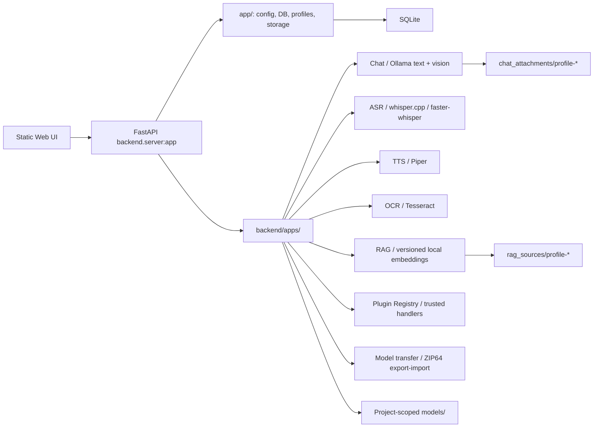

# Архитектура LocalGPT

## Обзор

LocalGPT — монолитный локальный runtime с feature-oriented backend mini-apps, общей FastAPI-композицией, статическим Web UI и локальным хранением данных. Целевая граница — `backend/apps/<feature>/`; shared и transitional код пока остаётся в `app/`.

## Runtime и точки входа

- `setup/setup_localgpt.command` / `.sh` / `.bat` обеспечивают native Terminal/PowerShell entry и первоначальный Python setup. Находящиеся рядом `setup_localgpt.py` и `.ps1` определяют ОС/package manager, после подтверждения ставят system/runtime dependencies из канонического `app/requirements.txt`, создают штатный `venv/` и выполняют final verification без установки речевых моделей или конфигурации. На macOS bootstrap также собирает `whisper-cli` и устанавливает Silero VAD для отсечения тишины, но не загружает GGML-модель или CoreML encoder. Это первичный bootstrap окружения.
- `run_localgpt.py` выполняет только повторяемый project setup: при прямом запуске старым bootstrap Python сначала re-exec-ит себя через совместимый `venv`/versioned Python, создаёт или переиспользует `venv/`, обновляет `app/requirements.txt` при изменении hash, проверяет и запускает Ollama, выбирает порт и запускает `uvicorn backend.server:app`.
- `backend/server.py` создаёт FastAPI app, подключает CORS, регистрирует shared и feature routers, монтирует `web_ui/` на `/ui` и перенаправляет `/` на UI.
- `app/server.py` импортирует `backend.server:app` и существует как compatibility shim.
- `web_ui/gui_html.html` — активная HTML-точка входа; она подключает `css/style.css` и ES module `js/app.js`.

## Слои и ответственность

### Composition layer

`backend/server.py` знает обо всех routers, но не содержит бизнес-логику. Новая feature-функциональность должна регистрироваться через свой mini-app router.

### Feature layer

`backend/apps/` содержит:

- `chat/` — подготовка prompt, text/vision Ollama runtime, model routing, image attachments, tasks, SSE и chat API;
- `asr/` — транскрибация, whisper backends, модели, история и transcript pipeline;
- `tts/` — provider contract, Piper, generation tasks, history и audio post-processing;
- `ocr/` — image-to-text pipeline;
- `rag/` — profile sources, indexing, retrieval и context assembly;
- `plugins/` — manifest registry, enabled state, docs API и trusted handlers.

### Shared / transitional layer

`app/` пока владеет:

- `config.py` — environment parsing, paths, model catalog и defaults;
- `db.py` — SQLite schema, migrations и repositories;
- `routes/` — profiles, sessions, models, storage, health/runtime и criteria;
- `services/` — shared model/storage/UI-support logic;
- `schemas/` — общие Pydantic contracts;
- `roles.py` и `prompts/` — backend-owned global policy и versioned default profile persona.

Старые feature imports в `app/` могут оставаться для совместимости, но новая реализация должна предпочитать `backend/apps/`.

## Основные data flows

### Chat

1. UI отправляет запрос в `POST /chat/tasks`.
2. Backend проверяет профиль, session и выбранную модель.
3. Для Auto Router `qwen3:0.6b` классифицирует запрос; backend валидирует/корректирует target model.
4. При включённом RAG выполняется scope-aware `hybrid_v2` search: вручную управляемые Markdown sources доступны активному профилю, а derived Chat/Vision/ASR sources — только исходной session. Независимые lexical и semantic candidate pools объединяются domain-neutral reciprocal-rank fusion; facet-first selection, repetition penalty и source diversity применяются после ownership filtering. `local-hash-v1` не считается semantic evidence и работает только через lexical pool. Backend формирует claim-evidence diagnostics (`supported`, `partial`, `conflict`, `not_found`) с source/chunk provenance; `lexical_v1` является штатным rollback без semantic query, а `legacy` сохраняет прежний ranking для диагностики совместимости. Context builder одновременно формирует structured manifest точных content spans и provenance только для реально включённых chunks. После generation sync и task paths строят lexical trace по этому manifest, исключая служебные rules, filenames, diagnostic query и отброшенные при truncation chunks/хвосты; source/chunk IDs поэтому относятся только к evidence, которое увидела модель. Диагностика различает `evidence_not_found`, traceable ответ и случай, когда evidence было найдено, но ответ с ним лексически не связан; последний статус является сигналом для review, а не доказательством семантической ошибки модели.
5. Prompt строится в фиксированном trust order: backend-owned global policy (L1), profile persona/configuration (L2), request data и current authorized evidence (L4), immutable guard, history/current query. RAG, summary, transcript, OCR/Vision-derived text, criteria и history всегда сериализуются как data envelopes и не становятся system-инструкциями.
6. Assistant message создаётся в SQLite до генерации и проходит состояния `generating`, `streaming`, `completed`, `failed` или `cancelled`.
7. Перед выдачей и сохранением backend проверяет final content/reasoning на буквальное повторение secret-like значений из L1/L2 и явно помеченного private session context. Non-streaming fail closed до ответа; streaming удерживает bounded tail, поэтому полный protected literal не успевает попасть клиенту. Та же граница применяется к vision runtime.
8. `stream=true` отдаёт lifecycle, отдельные `reasoning` chunks и final-answer `delta` через SSE; non-streaming использует тот же persisted lifecycle без chunk events.

Short history принадлежит только активной session. Profile setting `mem_turns` по умолчанию равен 6 и означает число последних завершённых пар `user + assistant`; `0` отключает history. Автоматическая summary memory получает только более старые завершённые пары, поэтому её input и retained short history не пересекаются. Chat-summary идентифицируется hash текущего completed-turn snapshot вместе с `mem_turns` и effective `max_context_chars`; edit, изменение границы или compression budget требует нового snapshot, а prompt source-aware получает совпадающий automatic chat-summary независимо от числа более новых summary rows. Compression режет input только между целыми turns и сохраняет counts/truncation metadata. Текущий query, orphan user rows и active/failed/cancelled/partial assistant rows не считаются turn, не сдвигают границу и не попадают ни в один из этих блоков.

До запуска generation backend проверяет per-block/aggregate input и assembled-prompt budget. Одновременно допускаются не более двух активных chat tasks на профиль и четырёх на runtime; worker имеет пятиминутный timeout с termination и удалением partial delta/reasoning artifacts. Status/events/cancel требуют совпадающие `profile_id` и `session_id`, а SSE ограничен тремя соединениями на task.

Native Ollama `message.thinking` отделяется от `message.content`: worker инкрементально сохраняет reasoning в поле assistant message и публикует его по отдельному replay-safe SSE `reasoning` channel. Terminal modal может показывать накопленный reasoning во время генерации, а после terminal state загружает persisted snapshot через ownership-checked запрос. Reasoning не попадает в SSE `delta`, обычную history/prompt или RAG. `output_tokens` задаёт бюджет финального ответа, `thinking_tokens` — allowance для рассуждения (default 4096, min 2048); когда provider не поддерживает два hard limits, каждый inference использует явно отмеченный bounded combined cap. Только явный `done_reason=length` с final content разрешает до четырёх дополнительных продолжений с тем же per-call budget внутри той же задачи; исходные prompt/RAG decision и direct Vision image evidence сохраняются без повторного retrieval. Exact overlap удаляется, privacy guard действует на склеенный ответ и через границы stream passes. Reasoning-only/empty exhaustion и исчерпание continuation cap остаются incomplete/failed, не completed history или summary.

Reasoning effort selection is separate from trace visibility. The Ollama model inventory obtains sanitized per-model controls/defaults from `/api/show`; `/model_settings` stores the choice per profile and model, and the native chat boundary sends only the exact declared boolean/string value (`auto` leaves the Ollama default). UI capability is never inferred from a model name. Installed models originating from Hugging Face work through this same Ollama path only after Ollama can run them; LocalGPT has no direct HF inference provider.

Если к сообщению приложены изображения, UI сначала загружает их через `POST /chat/attachments`. Backend валидирует ownership и лимиты, декодирует/нормализует PNG, JPEG или WebP, создаёт thumbnail и передаёт worker только internal descriptors. Модель с подтверждённой Ollama capability `vision` получает изображения напрямую через native `/api/chat`; при выбранной text-only модели vision-анализ создаёт производный текстовый context для конечного ответа. Base64 существует только в transient Ollama request и не сохраняется в chat messages, SQLite или RAG.

Attachment связан с profile, session, user message и task. Его persisted status следует стадиям `preparing`, `analyzing`, `loading_model`, `generating`, `completed`, `failed` и `cancelled`; после process loss reconciliation завершает оборванное состояние как failed. Удаление session/profile и database reset очищает принадлежащие им файлы.

Operational boundaries (`runtime` restart/shutdown, database cleanup/reset, storage paths и metadata-only debug) требуют непустой `ADMIN_TOKEN`; local/dev mode не является bypass. Public health/version, model inventory, TTS health и RAG status возвращают минимальные/безопасные metadata без filesystem paths и runtime host; routed chat/router/criteria/TTS 5xx не возвращают raw provider exceptions. Chat logs хранят длины/идентификаторы вместо query/reply/error payload.

### ASR

1. `POST /transcribe` или `/transcribe/tasks` получает audio/video.
2. Конфигурация выбирает whisper.cpp или faster-whisper.
3. Результат может быть сохранён как transcript.
4. Pipeline actions `summary`, `smart_summary`, `tasks`, `clean` и `full` запускают только разрешённые stages.
5. `full` блокируется, пока profile setting явно не разрешит полный анализ.
6. `Сохранить в контекст` создаёт `asr_context`, индексируемый RAG отдельно от обычного файла.

### TTS

UI обращается к `/tts/*`; service выбирает provider, валидирует голос, создаёт task, пишет output/history и при необходимости применяет изменение скорости. Текущий concrete provider — Piper.

### OCR

`POST /ocr/extract` принимает изображение, вызывает Tesseract, подбирает доступные языки и применяет эвристики очистки UI-noise. PDF OCR не реализован.

### RAG

Файлы профиля Markdown сканируются, текст разбивается на chunks, а versioned embeddings пишутся в SQLite. Compatibility generation `local-hash-v1` работает offline; опциональная локальная Ollama embedding generation включается только явно и требует matching reindex. `GET /rag/status` различает `ready`, `ingest_required`, `reindex_required` и `configuration_error`, не раскрывая paths/raw provider errors; явный `POST /rag/reindex` запускает единственную process-local background operation с profile-owned polling. Новое generation публикуется атомарно только если набор исходных chunks не изменился, прежние generations остаются доступны для rollback. Chat получает diversified top-k chunks только активного профиля; каждый файл создаёт один индексируемый источник. Preview-only corpus audit сообщает metadata о дублях/boilerplate, oversized/missing-heading/stale/conflicting и suspicious instruction-like sources, но ничего не удаляет.

Chat и Vision-ответы не индексируются автоматически. Пользователь может открыть общий редактируемый export: user или completed assistant message создаёт session-owned `chat_context`, а Vision flow — session-owned `vision_context`. ASR context также сохраняет session ownership. В index попадает только подтверждённый текст и безопасные ссылки/metadata, без reasoning, image binary и storage paths. Неоднозначные legacy derived rows без session ownership не участвуют в chat retrieval; отдельного promotion в profile-wide RAG пока нет.

### Plugins

Registry читает `plugins/*/plugin.json` как данные. Код из `plugins/` не импортируется. Поведение trusted plugins реализуется только в `backend/apps/plugins/`.

### Model transfer

`backend/apps/model_transfer/` формирует несжатый ZIP64 `.localgpt-models` из выбранных complete provider units. Browser download/upload не принимает filesystem paths. Import дважды проверяет manifest, размеры и SHA-256, выполняет conflict preflight и публикует файлы из backend-owned staging в текущие `config.MODEL_PATHS`; Ollama manifests записываются после blobs. Успешный, отменённый или неуспешный import удаляет свой временный upload-archive; Settings → System показывает оставшиеся архивы после прерванных flows и позволяет явно очистить только прямые regular `.localgpt-models` files в backend-owned upload directory.

## Storage

| Данные | Канонический путь | Git |
| --- | --- | --- |
| SQLite | `app/db/localgpt.db` | ignored |
| Chat/Ollama models | `models/ollama/` | ignored |
| ASR models | `models/whisper/`, `models/whisper_cpp/` | ignored |
| TTS models | `models/tts/piper/` | ignored |
| Caches | `models/hf_cache/`, `models/ctranslate2_cache/` | ignored |
| Profile RAG sources | `rag_sources/profile-<id>/` | ignored |
| Chat image attachments | `app/data/chat_attachments/profile-<id>/` | ignored except placeholder |
| TTS data | `app/data/tts/` | ignored except placeholders |
| Logs | `tmp_logs/` | ignored except `.gitkeep` |

SQLite содержит profiles, sessions, messages, chat attachment metadata, transcripts, model settings, pipeline runs, summary memory и RAG documents/chunks/embeddings. Database reset удаляет profile-owned DB data, attachment files и profile RAG folders, но не локальные модели.

## Networking и security boundaries

- Default bind — `127.0.0.1`; прямой public exposure отсутствует.
- CORS по умолчанию ограничен localhost и private/local address ranges.
- LAN launcher оставляет backend на localhost и проксирует его через Caddy HTTPS.
- Tailscale handler выполняет только read-only status checks и возвращает manual command/address metadata.
- Registry не исполняет plugin code и не делает untrusted plugin effectively enabled.
- LocalGPT не включает Funnel, port forwarding или public tunnels.

Подробности: [networking](knowledge/networking.md) и [plugins](knowledge/plugins.md).

## Runtime prompt

Каноническая глобальная policy (L1) — [`app/prompts/system_base.md`](../app/prompts/system_base.md). `app/roles.py` читает её при построении system prompt и применяет policy-only fallback только при ошибке/пустом файле. Persona/style не смешиваются с глобальной policy: versioned default persona хранится в profile preferences, а непустой существующий profile prompt при one-shot migration сохраняется без изменений. `backend/apps/chat/prompt_policy.py` владеет компактным immutable guard и structured envelopes для L2/L4 blocks. `prompt_blocks()` возвращает только metadata об order/trust/owner/role и не раскрывает prompt values. Копии runtime policy в документации не являются источником.

## Legacy и transitional architecture

- `app/server.py` и feature wrappers в `app/` — compatibility surface.
- `LTrnsrb.*` — legacy launcher aliases; основной naming — `LocalGPT` / `start_localgpt*`.
- `compare-branch/` — read-only reference, не импортируется runtime и удаляется только после отдельного parity review.
- Большие `web_ui/js/app.js` и `web_ui/css/style.css` остаются рабочим frontend; их модульный рефакторинг — отдельная задача.

## Подробности

- [Backend](knowledge/backend.md)
- [Providers](knowledge/providers.md)
- [Plugins](knowledge/plugins.md)
- [RAG](knowledge/rag.md)
- [Web UI](knowledge/ui.md)
- [Networking](knowledge/networking.md)
