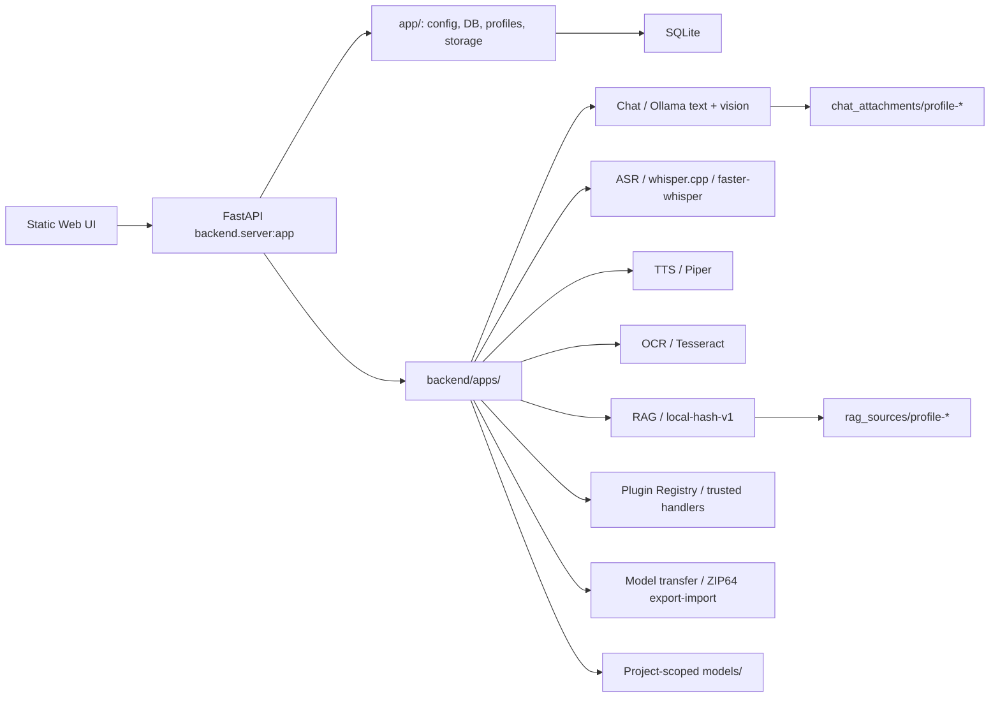

# Архитектура LocalGPT

## Обзор

LocalGPT — монолитный локальный runtime с feature-oriented backend mini-apps, общей FastAPI-композицией, статическим Web UI и локальным хранением данных. Целевая граница — `backend/apps/<feature>/`; shared и transitional код пока остаётся в `app/`.

## Runtime и точки входа

- `setup/setup_localgpt.command` / `.sh` / `.bat` обеспечивают native Terminal/PowerShell entry и первоначальный Python setup. Находящиеся рядом `setup_localgpt.py` и `.ps1` определяют ОС/package manager, после подтверждения ставят system/runtime dependencies из канонического `app/requirements.txt`, создают штатный `venv/` и выполняют final verification без установки моделей или конфигурации. На macOS bootstrap также собирает `whisper-cli`, но не загружает model artifacts. Это первичный bootstrap окружения.
- `run_localgpt.py` выполняет только повторяемый project setup: при прямом запуске старым bootstrap Python сначала re-exec-ит себя через совместимый `venv`/versioned Python, создаёт или переиспользует `venv/`, обновляет `app/requirements.txt` при изменении hash, проверяет и запускает Ollama, выбирает порт и запускает `uvicorn backend.server:app`.
- `backend/server.py` создаёт FastAPI app, подключает CORS, регистрирует shared и feature routers, монтирует `web_ui/` на `/ui` и перенаправляет `/` на UI.
- `app/server.py` импортирует `backend.server:app` и существует как compatibility shim.
- `web_ui/gui_html.html` — активная HTML-точка входа; она подключает `css/style.css` и ES module `js/app.js`.

## Слои и ответственность

### Composition layer

`backend/server.py` знает обо всех routers, но не содержит бизнес-логику. Новая feature-функциональность должна регистрироваться через свой mini-app router.

### Feature layer

`backend/apps/` содержит:

- `chat/` — подготовка prompt, text/vision Ollama runtime, model routing, image attachments, tasks, SSE и chat API;
- `asr/` — транскрибация, whisper backends, модели, история и transcript pipeline;
- `tts/` — provider contract, Piper, generation tasks, history и audio post-processing;
- `ocr/` — image-to-text pipeline;
- `rag/` — profile sources, indexing, retrieval и context assembly;
- `plugins/` — manifest registry, enabled state, docs API и trusted handlers.

### Shared / transitional layer

`app/` пока владеет:

- `config.py` — environment parsing, paths, model catalog и defaults;
- `db.py` — SQLite schema, migrations и repositories;
- `routes/` — profiles, sessions, models, storage, health/runtime и criteria;
- `services/` — shared model/storage/UI-support logic;
- `schemas/` — общие Pydantic contracts;
- `roles.py` и `prompts/` — base system prompt.

Старые feature imports в `app/` могут оставаться для совместимости, но новая реализация должна предпочитать `backend/apps/`.

## Основные data flows

### Chat

1. UI отправляет запрос в `POST /chat/tasks`.
2. Backend проверяет профиль, session и выбранную модель.
3. Для Auto Router `qwen3:0.6b` классифицирует запрос; backend валидирует/корректирует target model.
4. При включённом RAG выполняется profile-scoped search и собирается context.
5. Prompt строится из base system prompt, profile prompt/context, summary memory, RAG, transcript/criteria, короткой истории и текущего запроса.
6. Assistant message создаётся в SQLite до генерации и проходит состояния `generating`, `streaming`, `completed`, `failed` или `cancelled`.
7. `stream=true` отдаёт lifecycle и `delta` через SSE; non-streaming использует тот же persisted lifecycle без `delta`.

Если к сообщению приложены изображения, UI сначала загружает их через `POST /chat/attachments`. Backend валидирует ownership и лимиты, декодирует/нормализует PNG, JPEG или WebP, создаёт thumbnail и передаёт worker только internal descriptors. Модель с подтверждённой Ollama capability `vision` получает изображения напрямую через native `/api/chat`; при выбранной text-only модели vision-анализ создаёт производный текстовый context для конечного ответа. Base64 существует только в transient Ollama request и не сохраняется в chat messages, SQLite или RAG.

Attachment связан с profile, session, user message и task. Его persisted status следует стадиям `preparing`, `analyzing`, `loading_model`, `generating`, `completed`, `failed` и `cancelled`; после process loss reconciliation завершает оборванное состояние как failed. Удаление session/profile и database reset очищает принадлежащие им файлы.

### ASR

1. `POST /transcribe` или `/transcribe/tasks` получает audio/video.
2. Конфигурация выбирает whisper.cpp или faster-whisper.
3. Результат может быть сохранён как transcript.
4. Pipeline actions `summary`, `smart_summary`, `tasks`, `clean` и `full` запускают только разрешённые stages.
5. `full` блокируется, пока profile setting явно не разрешит полный анализ.
6. `Сохранить в контекст` создаёт `asr_context`, индексируемый RAG отдельно от обычного файла.

### TTS

UI обращается к `/tts/*`; service выбирает provider, валидирует голос, создаёт task, пишет output/history и при необходимости применяет изменение скорости. Текущий concrete provider — Piper.

### OCR

`POST /ocr/extract` принимает изображение, вызывает Tesseract, подбирает доступные языки и применяет эвристики очистки UI-noise. PDF OCR не реализован.

### RAG

Файлы профиля Markdown сканируются, текст разбивается на chunks, а deterministic embeddings пишутся в SQLite. Chat получает top-k chunks только активного профиля; каждый файл создаёт один индексируемый источник.

Vision-ответ не индексируется автоматически. Пользователь может открыть редактируемый export и явно создать source type `vision_context`; в index попадает только производный текст и безопасные ссылки на message/session/attachment ids, без image binary и storage paths.

### Plugins

Registry читает `plugins/*/plugin.json` как данные. Код из `plugins/` не импортируется. Поведение trusted plugins реализуется только в `backend/apps/plugins/`.

### Model transfer

`backend/apps/model_transfer/` формирует несжатый ZIP64 `.localgpt-models` из выбранных complete provider units. Browser download/upload не принимает filesystem paths. Import дважды проверяет manifest, размеры и SHA-256, выполняет conflict preflight и публикует файлы из backend-owned staging в текущие `config.MODEL_PATHS`; Ollama manifests записываются после blobs. Успешный, отменённый или неуспешный import удаляет свой временный upload-archive; Settings → System показывает оставшиеся архивы после прерванных flows и позволяет явно очистить только прямые regular `.localgpt-models` files в backend-owned upload directory.

## Storage

| Данные | Канонический путь | Git |
| --- | --- | --- |
| SQLite | `app/db/localgpt.db` | ignored |
| Chat/Ollama models | `models/ollama/` | ignored |
| ASR models | `models/whisper/`, `models/whisper_cpp/` | ignored |
| TTS models | `models/tts/piper/` | ignored |
| Caches | `models/hf_cache/`, `models/ctranslate2_cache/` | ignored |
| Profile RAG sources | `rag_sources/profile-<id>/` | ignored |
| Chat image attachments | `app/data/chat_attachments/profile-<id>/` | ignored except placeholder |
| TTS data | `app/data/tts/` | ignored except placeholders |
| Logs | `tmp_logs/` | ignored except `.gitkeep` |

SQLite содержит profiles, sessions, messages, chat attachment metadata, transcripts, model settings, pipeline runs, summary memory и RAG documents/chunks/embeddings. Database reset удаляет profile-owned DB data, attachment files и profile RAG folders, но не локальные модели.

## Networking и security boundaries

- Default bind — `127.0.0.1`; прямой public exposure отсутствует.
- CORS по умолчанию ограничен localhost и private/local address ranges.
- LAN launcher оставляет backend на localhost и проксирует его через Caddy HTTPS.
- Tailscale handler выполняет только read-only status checks и возвращает manual command/address metadata.
- Registry не исполняет plugin code и не делает untrusted plugin effectively enabled.
- LocalGPT не включает Funnel, port forwarding или public tunnels.

Подробности: [networking](knowledge/networking.md) и [plugins](knowledge/plugins.md).

## Runtime prompt

Канонический base prompt — [`app/prompts/system_base.md`](../app/prompts/system_base.md). `app/roles.py` читает его при построении system prompt и применяет fallback только при ошибке/пустом файле. Копии этого файла в документации не являются runtime-источником и не нужны.

## Legacy и transitional architecture

- `app/server.py` и feature wrappers в `app/` — compatibility surface.
- `LTrnsrb.*` — legacy launcher aliases; основной naming — `LocalGPT` / `start_localgpt*`.
- `compare-branch/` — read-only reference, не импортируется runtime и удаляется только после отдельного parity review.
- Большие `web_ui/js/app.js` и `web_ui/css/style.css` остаются рабочим frontend; их модульный рефакторинг — отдельная задача.

## Подробности

- [Backend](knowledge/backend.md)
- [Providers](knowledge/providers.md)
- [Plugins](knowledge/plugins.md)
- [RAG](knowledge/rag.md)
- [Web UI](knowledge/ui.md)
- [Networking](knowledge/networking.md)
