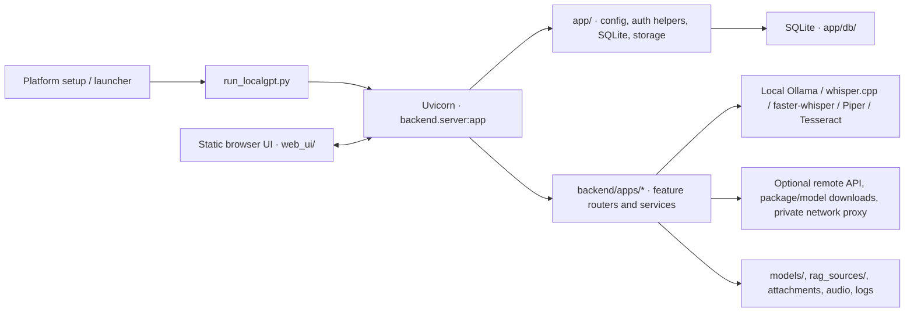

# LocalGPT — Open Source Readiness, Security & Distribution Audit

Дата проверки: 2026-10-21. Область: текущий checkout и Git refs, доступные в этом локальном репозитории. Это технический аудит реализации и release readiness, а не юридическое заключение.

## Executive Summary

**Вердикт: NOT READY FOR PUBLIC RELEASE.** В текущем checkout не найден известный P0; остаются три P1-блокера публикации: чувствительные данные и credential-like значения в доступной Git-истории, не-open-source root `License` с персональными контактными данными и отсутствие общей аутентификации для API-клиентов в явно включаемом LAN/Tailscale-сценарии. Первые два требуют приватных решений владельца, третий — отдельного security design или отказа от сетевого сценария до его закрытия.

В рамках аудита исправлены неограниченная обработка нескольких HTTP upload/archive путей и неявное включение LAN listener обычным macOS launcher-ом. Прямые уязвимые pins `python-multipart` и Pillow обновлены; полный deterministic Python suite проходит после исправления изоляции трёх тестовых наборов. Текущие локальные проверки не загружают модели и не обращаются к живым AI-provider-ам.

Результат не разрешает публикацию, push, смену видимости, изменение root-лицензии или rewrite общей Git-истории. Исторические значения не напечатаны и не скопированы в тесты или документацию.

## Архитектурная карта

- `setup/` prepares system and Python dependencies; the project launcher creates/reuses `venv/`, checks Ollama and starts `backend.server:app` through Uvicorn.
- `backend/server.py` composes FastAPI routes and serves the static UI. `app/server.py` is a compatibility import.
- Feature routers and services live in `backend/apps/{chat,asr,tts,ocr,rag,plugins,model_transfer}/`; shared transitional code and SQLite repositories live in `app/`.
- Chat and vision use Ollama by default. ASR uses whisper.cpp or faster-whisper, TTS uses Piper, OCR uses Tesseract, and RAG stores profile-scoped Markdown-derived records and embeddings locally.
- Plugins are manifests plus backend-owned trusted handlers. Arbitrary plugin code is not executed. Tailscale integration reads runtime status and exposes a manual command path.
- User data is persisted across restarts in SQLite and configured local storage. The repo does not encrypt the database or model/document files at rest; that depends on the host's disk and account controls.

More subsystem detail and the normal data flow are in [ARCHITECTURE.md](../ARCHITECTURE.md), [backend knowledge](../knowledge/backend.md), [providers](../knowledge/providers.md), [RAG](../knowledge/rag.md), [plugins](../knowledge/plugins.md), and [networking](../knowledge/networking.md).

Root `AGENTS.md` was reviewed and left unchanged: it already defines documentation ownership, staged progress, model routing, validation and no-publication boundaries. No project-specific instruction copy was added.

## Risk Register

P0 means an immediate critical exposure confirmed in the audited scope. P1 blocks public release. P2 needs a tracked remediation plan before a stable release. P3 is presentation or operational polish.

| Priority | Finding and evidence | Required action / status |
| --- | --- | --- |
| P0 | No confirmed P0 in the inspected working tree and available refs. This is not proof that every binary/large Git blob or remote ref is clean. | Keep the scope limitation attached to this conclusion. |
| P1 | Reachable Git history contains SQLite blobs with user chat records and `.env` blobs with non-empty `ADMIN_TOKEN` / `LOCAL_API_KEY` assignments. Whether any credential remains active is unknown. | Privately review exposure, rotate any still-valid credentials, remove user data, then obtain explicit owner approval for a coordinated history rewrite and rescan before any publication. Do not push this branch. |
| P1 | Root `License` says All Rights Reserved and contains a personal contact address. This does not grant general open-source redistribution rights. | Owner chooses a license and contact-disclosure policy after provenance/legal review. `License` was not modified. |
| P1 | There is no global caller identity/authentication on the FastAPI app. Ordinary launch now stays on localhost, but explicit LAN/Tailscale proxies can reach endpoints that do not require `ADMIN_TOKEN`; profile/session IDs are data ownership selectors, not identities. | Design and validate a consistent network-auth boundary, or keep network exposure disabled until one exists. TLS alone does not authenticate callers. |
| P2 | Setup can execute a downloaded package-manager script through `curl | sh`; macOS whisper.cpp builds from the moving repository default branch; downloaded VAD/model artifacts are not all pinned to checksums/revisions. | Pin source revisions and verify checksums/signatures; make remote install provenance explicit. |
| P2 | Direct Python requirements are version-pinned, but transitive dependencies have no lock/constraints file. Models and voice artifacts have separate licenses; model-transfer bundles do not preserve a verified per-artifact license/provenance record. | Add a tested lock strategy and artifact metadata/provenance before claiming reproducible or license-complete distribution. |
| P2 | `setup/` has macOS, Linux, and Windows entry points, but a clean end-to-end install was not run on each OS. This task host is Darwin 27.0.0 arm64 with Python 3.14.6 and Node 26.11.1. | Validate fresh setup and full lifecycle on each platform before claiming support. Current host and CI checks do not establish the full OS support matrix. |
| P2 | There is no private vulnerability disclosure process (`SECURITY.md` or another configured channel). | Select and configure a private reporting channel before opening the repository. |
| P3 | README is Russian-only, has no screenshot, and cannot give a fixed RAM/disk minimum because model choices vary. GitHub About/topics and release text were prepared below but not applied. | Add reviewed English/public media and tested hardware guidance if desired; do not invent benchmarks. |

### Security and privacy details

- **History scan:** a local pattern scan examined 1,817 reachable text blobs below 1 MiB. It found the historical credential assignments and SQLite user records described above. No private-key header or common provider-token prefix was found in that text scope. Nine binary or larger blobs were excluded; the scan is not equivalent to a complete signed secret-scanner review, and refs unavailable in this checkout are outside scope. No historical secret values or message text are reproduced here.
- **Current tree:** runtime `.env`, SQLite databases, models, RAG sources, attachments, audio and logs are covered by current ignore rules; `.env.example` is the tracked template. An ignore rule does not remove data already committed to history.
- **Secrets tooling:** `detect-secrets` 1.5.0 is added to the PR workflow for tracked working-tree content, with three known synthetic security-test candidates recorded in `.secrets.baseline`. On a failure, the CI wrapper logs only the path, detector and line, not the candidate value. CI does not scan Git history. The workflow's pass does not close the historical exposure.
- **Authentication:** `ADMIN_TOKEN` protects selected administrative/runtime/database/storage/debug operations. It is not a global login, and many API operations remain accessible to a local process or a client that can reach the API through an explicit proxy. CORS is not authentication.
- **Network posture:** ordinary launchers now bind the API to loopback and do not start Caddy LAN access. macOS ordinary startup also stops the LocalGPT-managed Caddy listener from a previous LAN session. Separate LAN launchers are explicit; Tailscale Serve remains manual. No public bind, Funnel, or port forwarding was introduced.
- **Uploads:** ASR, OCR and criteria uploads now use bounded streaming with limits of 100 MiB, 20 MiB and 20 MiB. Model-transfer upload is capped at 50 GiB; ZIP preflight bounds central-directory size and entry count, manifest size is capped at 8 MiB before JSON read, and extraction bounds counts, total size, hashes and duplicate/encrypted entries. These are resource caps, not an end-to-end malware scan.
- **Path and plugin review:** inspected plugin-doc and model-transfer path containment; manifests are treated as data and untrusted plugins have no execution path. These checks do not sandbox trusted backend handlers or downloaded native tools.
- **SAST:** Bandit 1.9.4 scanned `app/` and `backend/`: 69 findings (21 medium, 48 low, 0 high). The medium findings were 12 B608 dynamic SQL constructions in `app/db.py`, eight B310 URL-opening calls and one B615 Hugging Face download without a pinned revision. Manual review found the SQL values parameterized and interpolated identifiers assembled from code-owned field lists; the URL calls use a fixed Google Sheets host, fixed project catalog URLs, or configured provider base URLs; no request-body URL is passed directly to those calls. B615 matches the unpinned model/source provenance issue already tracked as P2. Bandit warnings are not proof that the remaining code is safe.
- **CI SAST scope:** Bandit runs on changed Python files at medium+ severity and high confidence. This catches new high-confidence issues without treating existing findings as new regressions; the full-tree findings above remain visible for follow-up.
- **Temporary files and lifecycle:** upload staging cleanup is covered on success/error/oversize paths; ASR task and cancellation/lifecycle behavior has deterministic coverage. This audit did not conduct a live crash/power-loss durability test.
- **External connections:** local Ollama, local binaries and local SQLite can keep inference and storage on the host. Configured OpenAI-compatible providers, model/package downloads, Hugging Face access, system package managers, and explicit LAN/Tailscale access can communicate outside the process or device. Local-first is not a guarantee of offline operation or privacy against the configured provider/network.

### Dependency and artifact review

- `python-multipart` was upgraded from `0.0.27` to `0.0.31` following the published [PYSEC-2026-3040 advisory](https://osv.dev/vulnerability/PYSEC-2026-3040). Pillow was upgraded from `12.3.0` to `13.0.0`; Pillow 13 requires Python 3.11+, so the project minimum was aligned across setup and launch entry points ([Pillow 13.0.0 release notes](https://pillow.readthedocs.io/en/latest/releasenotes/13.0.0.html)).
- Isolated `pip-audit==2.10.1 -r app/requirements.txt` reported no known vulnerabilities on 2026-10-21 after those upgrades. This is a point-in-time dependency scan, not a guarantee against future advisories.
- Piper's direct runtime package `piper-tts==1.4.2` declares GPL-3.0-or-later ([package metadata](https://pypi.org/project/piper-tts/1.4.2/), [upstream COPYING](https://github.com/OHF-Voice/piper1-gpl/blob/v1.4.2/COPYING)). The project license relationship needs owner/legal review; this report does not determine compatibility.
- Piper voice and model licenses vary. For example, the upstream Ryan low voice card is CC BY-NC-SA 4.0 ([voice model card](https://huggingface.co/rhasspy/piper-voices/blob/main/en/en_US/ryan/low/MODEL_CARD)). Do not infer rights for other voices from this example or from the software license.
- Whisper.cpp is MIT-licensed upstream ([license](https://github.com/ggml-org/whisper.cpp/blob/master/LICENSE)); that does not assign licenses to downloaded models or VAD assets. Hugging Face/Ollama artifact terms must be reviewed per artifact.
- Current source review did not identify a separate trial/activation subsystem in the audited paths. This does not change the root license or authorize release. No private signing key was printed or added; the binary/large-blob limitation above still applies.

## Install, configuration and functional smoke status

| Lifecycle area | Deterministic evidence in this checkout | Live / clean-install limit |
| --- | --- | --- |
| Setup and launch | OS/bootstrap contract tests, launcher tests, shell syntax checks; default launch contract is localhost-only. | No fresh macOS end-to-end bootstrap or repeat-start/stop on a clean machine. Linux/Windows setup not verified. |
| API and storage | FastAPI TestClient coverage, temporary SQLite DBs, schema/migration tests and health/UI static checks. | No separate live process/API smoke was performed for this audit. |
| Chat and model states | Mocked provider/model lifecycle, persistence, streaming/task, error and authorization cases. | No Ollama server or model generation run. |
| RAG | Synthetic Markdown, temporary DB and deterministic `local_hash` retrieval fixtures. | No live embedding/LLM call or user corpus. |
| ASR | Synthetic pipeline outputs, upload/task/cancel and mocked provider contracts. | No speech model/audio pipeline execution. |
| TTS | Route/provider and audio post-processing tests with synthetic fixtures/mocks. | No Piper voice download or live audio generation. |
| OCR | Image-validation and OCR heuristic/API fixtures. | No new Tesseract language-pack or image-recognition smoke on another OS. |
| Settings and model transfer | Temporary storage, mocked download/provider operations, ZIP/import/export boundary cases. | No large model transfer, external catalog pull or model load. |

On this task branch, the Python suite passed **433/433** with `RAG_EMBEDDING_PROVIDER=local_hash`, and the Node suite passed **51/51** after the report and README edits. Static compile, changed-file Ruff/Bandit checks and launcher contract checks also passed. The CI workflow adds a clean Ubuntu/Python 3.11 dependency install, test, audit and web checks, but this local task cannot report a GitHub Actions run before the branch is pushed. The repo has no distributable package/build target; `compileall` is a source validation, not a release artifact build. No clean full-app installer run or hardware/performance benchmark is claimed.

The repository defines Python **3.11+**. It does not define a reliable minimum RAM, VRAM or disk size: requirements depend on chosen model and pipeline. No universal GPU requirement is established; model compatibility and useful speed vary by device. Ollama, FFmpeg and Tesseract are core runtime components for their documented feature paths; Caddy and Tailscale are optional. Setup and model retrieval require network access when packages/artifacts are missing.

## Public presentation drafts (not applied)

**GitHub About:** “Local-first AI workbench for chat, speech transcription, speech synthesis, OCR and profile-scoped RAG.”

**Suggested topics:** `local-ai`, `ollama`, `fastapi`, `rag`, `speech-to-text`, `text-to-speech`, `ocr`, `self-hosted`, `python`.

**Release description draft:** “LocalGPT combines a static browser UI and FastAPI backend with local Ollama chat/vision, ASR, TTS, OCR and profile-scoped RAG. Local models and data can stay on the host; configured external providers and downloads can use the network. See the platform matrix and security notes before installation.” Use only after the P1 release gates, license/provenance decisions, and clean-install checks are complete. No benchmark claim is included.

## Owner release checklist

- [ ] Privately rotate historical credentials that remain valid; assess incident scope.
- [ ] Remove user data/credentials from reachable history through an owner-approved rewrite plan, then independently scan all refs and binary/LFS objects.
- [ ] Select the project license and resolve Piper/package/model/voice/data provenance with qualified legal review; remove or replace personal contact data under owner direction.
- [ ] Decide how to handle unauthenticated LAN/Tailscale callers: implement and test a global identity boundary or disable those entry points for the public release.
- [ ] Configure a private vulnerability disclosure channel.
- [ ] Pin bootstrap and model-build inputs, verify artifact checksums/signatures, and add a dependency lock/constraints strategy.
- [ ] Complete clean install → configure → explicit model setup → synthetic/live-approved smoke → restart/persistence → shutdown on each claimed OS. Record hardware and network limits.
- [ ] Review README language, add an approved screenshot or local demo, and confirm system requirements and troubleshooting on a fresh install.
- [ ] Run the new CI after pushing to a private review remote; resolve findings and verify dependency/secret scan output. CI does not scan history.
- [ ] Review GitHub About/topics/release draft; prepare known-issues and release notes with no unsupported benchmark.
- [ ] Re-run history, license, dependency, install and security review on the exact commit/tag. Publish only with owner approval.

## Final assessment

The codebase has meaningful local AI modules, profile-scoped persistence, bounded upload handling, deterministic tests and an explicit local-only default. The branch improves safe defaults and adds repeatable quality gates. Public release remains blocked until the P1 history, licensing and network-authentication issues have owner-approved remediation and independent verification. Linux/Windows support, fresh macOS installation, external-provider privacy, artifact licensing, and binary/history coverage remain unverified or incomplete as described above.
